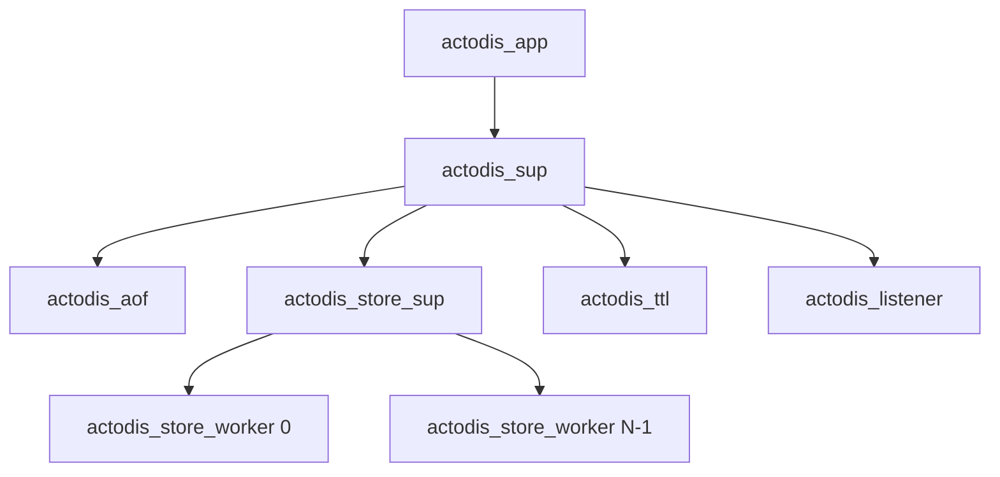

# US-004: Append-Only File Durability Engine And Crash Recovery

## Metadata
- **Story ID:** US-004
- **Title:** Append-Only File Durability Engine And Crash Recovery
- **Slug:** US-004-append-only-file-durability-engine-crash-recovery
- **Domain Capability:** Persistence & Durability
- **Depends On:** [US-002, US-003]
- **Complexity:** 30 CU
- **Change Type:** new

---

## Executive Summary

This story implements the `actodis_aof` durability actor and startup replay sequence. The system records all keyspace mutations (`SET`, `DEL`, `INCR`, `DECR`, `EXPIRE`, `FLUSHALL`) to an append-only file named `dump.aof`. Expiring keys are recorded with absolute UNIX epoch timestamps. On restart, the system replays the log file into memory before the TCP listener accepts incoming traffic. If the final log entry is incomplete, the engine truncates the partial record. The engine logs `actodis: recovered truncated AOF` and restores valid preceding records.

---

## User Story

As a database operator,
I want actodis to persist all data mutations to an append-only disk log with absolute expiration timestamps,
So that in-memory state and accurate remaining time-to-live values survive node restarts and process crashes.

---

## Architectural Context & Supervision Seam

The supervisor tree launches `actodis_aof` before launching the client listener. Store workers or command dispatchers stream mutation events to `actodis_aof` via asynchronous or synchronous calls. The file worker controls the file descriptor.



1. `actodis_app:start/2` initializes the AOF directory from `ACTODIS_DATA_DIR` (default `./data`).
2. `actodis_aof:replay/2` reads `dump.aof` line by line, executing commands into the store facade.
3. Replay evaluates timestamps with the injected clock. It discards expired keys immediately.
4. `actodis_listener` starts only after replay finishes successfully.

---

## Wire & File Format Contracts

### Disk File Name and Format
- **Path:** `$ACTODIS_DATA_DIR/dump.aof`.
- **Encoding:** Standard RESP2 Multi-Bulk format (`*<argc>\r\n$<len>\r\n<arg>\r\n...`).
- Every mutation must serialize as a RESP command array:
  - `SET key value` -> `*3\r\n$3\r\nSET\r\n$<klen>\r\n<key>\r\n$<vlen>\r\n<val>\r\n`
  - `DEL key [keys...]` -> standard `DEL` array.
  - `INCR key` / `DECR key` -> logged as exact arithmetic result `SET key <new_val>` or original command.
  - `EXPIRE key ttl` -> translated and written as absolute expiration command: `*3\r\n$8\r\nEXPIREAT\r\n$<klen>\r\n<key>\r\n$<tlen>\r\n<epoch_timestamp>\r\n`.
  - `SET key value EX seconds` -> written as `SET key value` followed by `EXPIREAT key <epoch_timestamp>`.
  - `FLUSHALL` -> truncates the `dump.aof` file to 0 bytes on disk.

### Fsync Modes
- Environment variable `ACTODIS_AOF_FSYNC` controls synchronization.
- When `ACTODIS_AOF_FSYNC=true` (default), invoke `file:sync/1` on each write.
- When `ACTODIS_AOF_FSYNC=false`, let the host operating system manage page writeback.

### Crash Recovery & Truncation Handling
- If the process terminates while writing, the file contains a partial trailing RESP frame.
- Replay must detect incomplete frames at EOF.
- When an incomplete frame occurs at EOF:
  1. Truncate the file to remove the broken tail.
  2. Emit log line to standard output: `actodis: recovered truncated AOF`.
  3. Proceed with startup.
- If an invalid byte sequence appears in the middle of the file before EOF, abort startup with exit code `1` and print `actodis: fatal corrupt AOF at offset <N>`.

---

## Acceptance Criteria

### AC-1: AOF File Creation and Directory Handling
1. Given that `$ACTODIS_DATA_DIR` does not exist on startup,
2. When `actodis_aof:init/1` executes,
3. Then create directory `$ACTODIS_DATA_DIR` with mode `0755`.
4. Open `$ACTODIS_DATA_DIR/dump.aof` in append and binary mode.

### AC-2: Mutation Logging with Absolute Timestamp
1. Given a running actodis node,
2. When a client executes `SET user:1 alice EX 30` at epoch `1700000000`,
3. Then append a valid RESP command sequence to `dump.aof`.
4. Ensure the log entry specifies absolute expiration `1700000030` via `EXPIREAT`.

### AC-3: Startup Log Replay
1. Given a non-empty `dump.aof` file containing valid mutations,
2. When actodis restarts,
3. Then replay all mutations into `actodis_store` before binding the TCP port.
4. Ensure all restored keys match their previous values.

### AC-4: Absolute Expiration Pruning During Replay
1. Given a record in `dump.aof` with expiration timestamp `1700000050`,
2. When actodis restarts with injected system clock at `1700000060`,
3. Then discard the expired key during log replay.
4. Confirm `GET` for the key returns `$-1\r\n` (nil bulk).

### AC-5: Incomplete Trailing Line Recovery
1. Given a `dump.aof` file ending with an incomplete RESP frame `*3\r\n$3\r\nSET\r\n`,
2. When actodis starts up,
3. Then truncate the partial frame from the end of the file.
4. Print `actodis: recovered truncated AOF` to standard output.
5. Complete startup successfully and service client requests.

### AC-6: FLUSHALL File Truncation
1. Given a node with existing mutations recorded in `dump.aof`,
2. When the client executes `FLUSHALL`,
3. Then truncate `dump.aof` to zero bytes.
4. Return `+OK\r\n` to the client.

---

## Comprehensive Scenario & Edge Case Matrix

| Case ID | Scenario / Input | Condition | Expected Result |
|---|---|---|---|
| SC-01 | Empty AOF file | First startup with 0 byte file | Complete replay instantly, start server cleanly. |
| SC-02 | Sequential mutations | Multiple `SET`, `INCR`, `DEL` calls | Replay accurately reflects final keyspace state. |
| SC-03 | Expired key replay | Current clock > `EXPIREAT` time | Key is omitted from keyspace during replay. |
| SC-04 | Active key replay | Current clock < `EXPIREAT` time | Key is restored; TTL equals remaining seconds. |
| SC-05 | Corrupted tail record | Sudden kill during write | Prune tail bytes, log notice, load previous keys. |
| SC-06 | Corrupted middle record | Corrupted bytes before valid lines | Halt startup with exit code 1; log fatal corrupt error. |
| SC-07 | Multi-key DEL logging | `DEL k1 k2 k3` executed | Log command; replay removes all specified keys. |
| SC-08 | FLUSHALL on disk | Non-empty log file | File size becomes 0 bytes; in-memory store is empty. |
| SC-09 | Fsync enabled | `ACTODIS_AOF_FSYNC=true` | Call `file:sync/1` on each mutation transaction. |
| SC-10 | Fsync disabled | `ACTODIS_AOF_FSYNC=false` | Write without immediate fsync call. |

---

## Pinned Implementation Files

Every module listed below is required. Modules must not introduce circular dependencies:
- `src/actodis_aof.erl`: Append-Only File `gen_server` writer and replay engine.
- `src/actodis_app.erl`: Application supervisor startup wiring replay prior to listener start.
- `src/actodis_commands.erl`: Hook dispatcher mutations to notify `actodis_aof`.
- `src/actodis_store.erl`: Route replay commands into partitioned worker actors.
- `test/actodis_aof_tests.erl`: Unit and property tests for recovery, replay, and mock time.

---

## Verification Criteria & Test Plan

1. Run `make test` (`rebar3 eunit`). All unit test suites must pass with zero failures.
2. In `test/actodis_aof_tests.erl`, execute tests using an isolated temporary directory:
   - Verify valid mutation writes and binary byte match.
   - Verify deterministic time travel during replay with mock clock.
   - Inject truncated line `*3\r\n$3\r\nSET\r\n$1\r\na\r\n` at file end and assert recovery.
   - Verify file truncation after `FLUSHALL`.
3. Run integration durability test in `test/actodis_integration_tests.erl`:
   - Write keys over TCP socket.
   - Stop application without deleting data directory.
   - Restart application.
   - Assert keys and remaining TTL values match.
4. Run `make lint` (`rebar3 dialyzer`). Zero dialyzer warnings allowed.

---

## Machine-Readable Story Contract

```noctifab-contract
{
  "story_id": "US-004",
  "public_contracts": [
    {
      "id": "aof-replay-durability",
      "interface": "file-and-tcp",
      "allowed_executables": ["rebar3", "erl", "redis-cli"],
      "exit_codes": [0],
      "stdout_contains": ["actodis: recovered truncated AOF"],
      "stderr_prefixes": ["actodis: "]
    }
  ]
}
```
